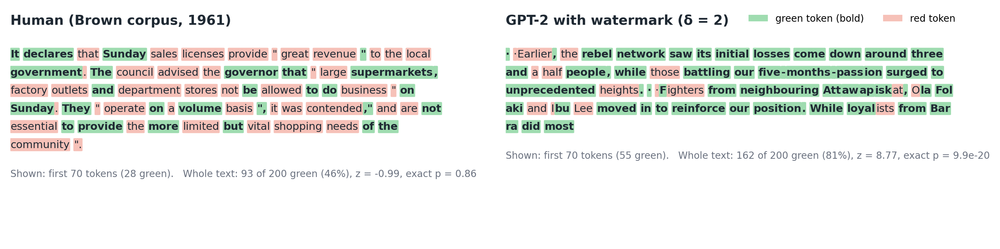
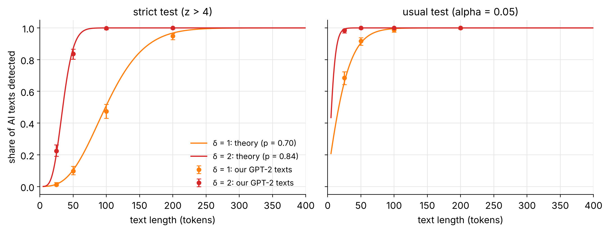
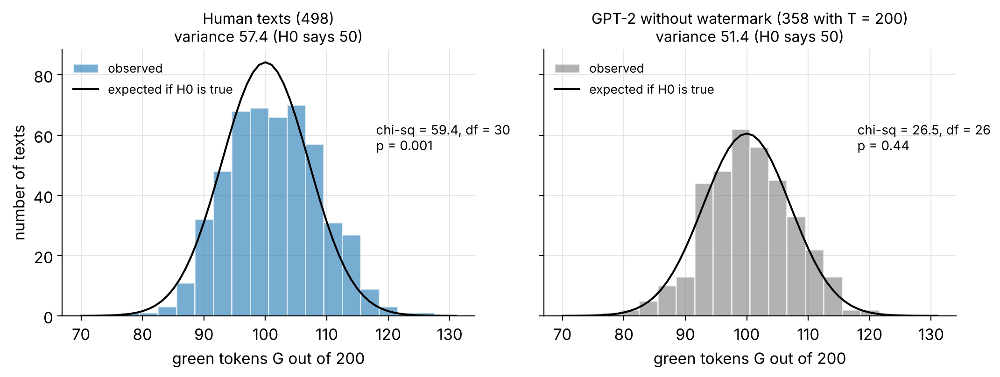

# Catching AI-written text with a statistical watermark

Course project for **MATH F432 Applied Statistical Methods** (Assignment 2), BITS Pilani, Pilani Campus, November 2026.

We built the green/red-list watermark of Kirchenbauer et al. (ICML 2023) on GPT-2, generated 1,992 texts, and studied the detector as a statistics problem: a one-proportion hypothesis test, its error rates and power, a check of whether real human text really follows the null hypothesis, a regression of the evidence on text length, and a p-control chart that finds the AI-written part of a document.



*Left: real 1961 text. Right: GPT-2 continuing the same opening with the watermark on. Both read normally, but with the key the watermarked text is 81% green, the human text 46%.*

## Results at a glance

| Question | Answer from our data |
|---|---|
| Does the test work? | A δ = 1 GPT-2 text had 140 green tokens out of 200: z = 5.66, exact p = 7.5 × 10⁻⁹. The human text from the same prompt had 93 green, z = −0.99. |
| How often does it accuse a human? | At our cut-off z > 4, about 1 human text in 31,600 under H0. **0 of 498** human texts were flagged. |
| How much text is needed? | With z > 4, the weak watermark (δ = 1) is caught 1%, 10%, 47% and **95%** of the time at 25, 50, 100 and 200 tokens; the strong one (δ = 2) 22%, 84%, 100%, 100%. About 141 and 46 tokens give 80% power. |
| Does human text follow H0? | **Not exactly.** Under our key, 9.4% of human texts are flagged at α = 0.05 instead of 5% (p = 4.8 × 10⁻⁵); goodness of fit χ² = 59.4, df = 30, p = 0.001. Unwatermarked GPT-2 passes (5.8%, p = 0.41). Calibrating on human text brings it back to about 5%. |
| Is there a general law? | z grows with √length. Fitted slopes 0.400 (δ = 1) and 0.683 (δ = 2) against the theory value 2(p − 0.5) = 0.403 and 0.682. |
| Can we find the AI part? | A p-chart on 50-token windows put **97%** of AI windows above the upper control limit and none of the human windows. |

## How the watermark works

1. **Split the vocabulary.** Before each token, the previous token and a secret key are hashed (SHA-256) into a seed. The seed shuffles GPT-2's 50,257 tokens and the first half (γ = 0.5) becomes the *green list*.
2. **Nudge the model.** δ is added to the score of every green token before softmax, so green tokens become more likely. With δ = 2 a green token's weight is multiplied by e² ≈ 7.4. GPT-2 itself is not retrained.
3. **Detect with the key only.** The detector re-tokenizes the text, rebuilds every green list and counts the green tokens G out of T.
4. **Test.** Under H0 (no watermark) each token is green with probability 0.5, so G ~ Binomial(T, 0.5) and

   z = (G − T/2) / √(T/4).

   We flag a text only if z > 4, because a false accusation is the costly mistake.

`analysis/demo.py` walks through the same steps on a four-word toy example with numbers small enough to check by hand.

## Data

- **Human text:** 498 passages from the Brown corpus (1961), so certainly human, with genre labels (press 88, nonfiction 284, fiction 126). From each passage we take a prompt of at least 30 tokens and the author's real continuation of at least 260 tokens. The first ~1,000 words of each passage were kept for an early practice model (`wm/prototype/`).
- **AI text:** GPT-2 small continues each prompt three times: δ = 0 (no watermark, the control group), δ = 1 (weak) and δ = 2 (strong). Plain sampling (temperature 1, no top-k or top-p), fixed seeds, at least 200 new tokens.
- **Scoring:** every text is scored on its first 200 tokens (also cut to 25, 50 and 100), from the text alone, exactly as a real detector would see it. That gives 1,992 texts and 7,968 text-length rows.

## What we analysed

| Part | Question | Methods | Main figure |
|---|---|---|---|
| The test | Can we test for the pattern? | One-proportion z-test, exact binomial test, continuity correction | [`null_distribution.png`](figures/null_distribution.png), [`exact_vs_z.png`](figures/exact_vs_z.png) |
| Errors and power | How often is the test wrong? | Type I and II errors, power, sample size, Bayes' theorem, Wilson intervals | [`power_curves.png`](figures/power_curves.png), [`bayes.png`](figures/bayes.png) |
| Checking H0 | Does human text really behave like coin flips? | Chi-square goodness of fit, exact one-proportion test, t-test, dispersion test, 20-key study, split-half calibration | [`gof_human_vs_gpt2.png`](figures/gof_human_vs_gpt2.png), [`keys_false_positive.png`](figures/keys_false_positive.png) |
| Modelling | Is there a general law? | Regression of z on √T, one length per text, log-log fit | [`regression.png`](figures/regression.png) |
| Finding the AI part | Which part of a document is AI? | p-control chart, 3σ limits | [`pchart_delta2.png`](figures/pchart_delta2.png) |

<p>


</p>

### Why human text fails H0

A token's colour depends only on the token and the one before it, so a word pair always gets the same colour under a given key. Two things follow:

1. **Pairs shared by all texts shift the mean.** "of the" appears 768 times in our human texts and is green under our key. The 50 most common pairs make up 7.0% of human tokens and 54.7% of them are green, so the whole corpus leans slightly green (mean z = 0.19). With another key the lean changes: over 20 keys the false-alarm rate at α = 0.05 ranges from 1.4% to 12.0%.
2. **Phrases repeated inside a text widen the spread.** A writer repeats names and phrases, and every repeat gets the same colour, so a text has fewer independent coin flips than tokens (variance of G 57.4 instead of 50; SD of z above 1 under 19 of 20 keys).

Counting each repeated pair once per text, or calibrating the test on half of the human texts and checking it on the other half, brings the false-alarm rate back to about 5% (calibrated: 2.4% to 8.4% over 20 keys, mean 5.3%). At the strict z > 4 cut-off the effect barely matters.

## Repository layout

```
├── wm/                        generation: human texts, GPT-2 watermark, Colab notebook
│   ├── Watermark_GPT2_Colab.ipynb   generates and scores all 1,992 texts (run on a T4 GPU)
│   ├── watermark_core.py            shared green-list function and detector
│   ├── gpt2_watermark.py            watermark as a Hugging Face logits processor
│   ├── make_human_texts.py          builds data/human_texts.csv from the Brown corpus
│   ├── data/human_texts.csv         498 prompts and human continuations
│   ├── prototype/                   early trigram stand-in model, used before GPT-2
│   └── tests/                       checks of the GPT-2 code with a tiny random model
├── analysis/                  statistics on the generated texts
│   ├── watermark.py                 detector and p-chart limits (same green lists as wm/)
│   ├── results.py                   builds the shared analysis table, pilot report
│   ├── chapter_tests.py             the test, errors and power, extra H0 checks, regression
│   ├── chapter5_keys.py             goodness of fit, 20-key study, calibration
│   ├── pchart.py                    p-chart on mixed human/AI documents
│   ├── make_figures.py              every figure in figures/
│   └── demo.py                      the toy example, step by step
├── results/                   outputs of the analysis on GPT-2 (see results/README.md)
├── figures/                   all plots used in the slides
└── docs/                      slides and the project guide
```

The file names say "chapter" because the analysis was split into chapters while we worked: 3 the test, 4 errors and power, 5 checking H0, 6 modelling, 7 the p-chart.

## Reproducing the results

```bash
pip install -r requirements.txt
```

**1. Generate the texts (optional, about 15 minutes on a free Colab GPU).** Open `wm/Watermark_GPT2_Colab.ipynb` in Google Colab, choose a T4 GPU and run all cells, uploading `wm/data/human_texts.csv` when asked. It produces `results_gpt2.csv`; our copy is already in `results/`.

**2. Run the analysis** (from `analysis/`):

```bash
cd analysis

# pilot report: green share per δ, power by length, p-chart windows
python results.py ../results/results_gpt2.csv --pilot

# shared table: every text at 25, 50, 100 and 200 tokens (7,968 rows)
python results.py ../results/results_gpt2.csv --lengths 25 50 100 200 --out ../results/analysis_table_gpt2.csv

# the test, errors and power, extra H0 checks, regression ('raw' = every token counted, as in the slides)
python chapter_tests.py ../results/analysis_table_gpt2.csv raw ../results/results_gpt2.csv

# goodness of fit, 20 keys, calibration (about 10 minutes)
python chapter5_keys.py ../results/results_gpt2.csv --keys 20 --out ../results/chapter5_keys_gpt2.csv

# p-chart: 50 documents of 400 human + 200 AI + 400 human tokens
python pchart.py ../results/results_gpt2.csv --delta 2 --window 50 --docs 50 --png ../results/pchart_gpt2_d2.png --csv ../results/pchart_gpt2_d2.csv

# every figure
python make_figures.py ../results/results_gpt2.csv ../results/analysis_table_gpt2.csv ../results/chapter5_keys_gpt2.csv ../figures/
```

Every analysis script recomputes the green counts of a few texts on load and stops if they do not match the generation file, so generator and detector are always using the same green lists. Re-running these commands reproduces every number in `results/`.

The three `fig_*_gpt2.png` figures are drawn by the Colab notebook (`wm/figures.py`).

## Slides and guide

| File | What it is |
|---|---|
| [`docs/Presentation_slides.pptx`](docs/Presentation_slides.pptx) | The 15-minute presentation |
| [`docs/Detailed_submission_slides.pptx`](docs/Detailed_submission_slides.pptx) | The detailed submission deck, with every test and result |
| [`docs/Project_guide.pdf`](docs/Project_guide.pdf) | The whole project explained step by step, with worked examples |

## Limitations

- Everything depends on the key staying secret; anyone with the key can also fake the pattern.
- Editing and paraphrasing weaken the watermark. We did not test this ourselves.
- Under about 50 tokens the strict test misses most AI text, and for short texts the exact binomial test should replace the z-test (at 25 tokens the z-test flags 6.8% of human texts, the exact test 1.8%).
- "Not flagged" does not mean human: we only detect this one watermark.
- The human texts are from 1961 and GPT-2 is a small, older model, so exact percentages would change with newer text and models.
- In the p-chart study, consecutive documents share their human sections, so the 750 human windows contain about 400 distinct ones.

## Team

Dilesh, Nayan, Priyanshu, Pratyush, Aditya, Aaditya and Navneet.
Supervisors: Prof. Niladri Chatterjee and Prof. Sumanta Pasari, Department of Mathematics, BITS Pilani.

## References

- Kirchenbauer, J. et al. (2023). A Watermark for Large Language Models. *ICML 2023*.
- Dathathri, S. et al. (2024). Scalable watermarking for identifying large language model outputs. *Nature* 634, 818–823.
- Francis, W. N. and Kučera, H. (1979). *Brown Corpus Manual*. Brown University.
- Radford, A. et al. (2019). Language Models are Unsupervised Multitask Learners (GPT-2). OpenAI.
- Montgomery, D. C. (2019). *Introduction to Statistical Quality Control*, 8th ed. Wiley.
- Wilson, E. B. (1927). Probable inference, the law of succession, and statistical inference. *JASA* 22, 209–212.

## Licence

Code is released under the MIT licence (see `LICENSE`). The human texts come from the Brown corpus as distributed with NLTK, and the generated texts come from GPT-2 small (OpenAI); please follow their terms when reusing the data.
